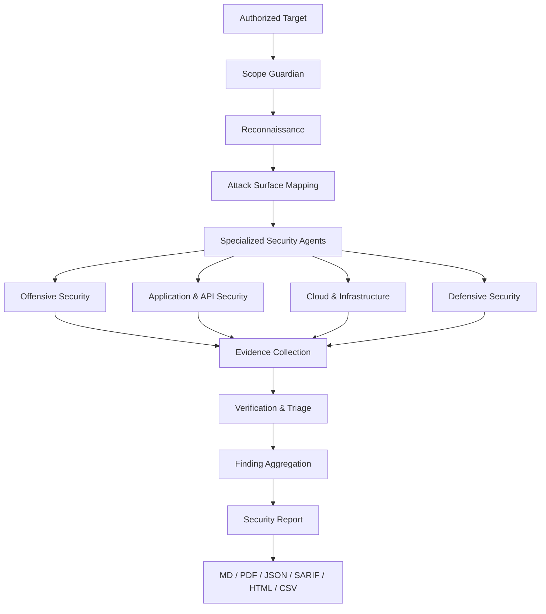

<p align="center">
  
</p>

# wanted

### Security operations, orchestrated.

A security operations library for Claude Code, bringing together **287 skills, 37 commands, and 38 specialized subagents** to turn authorized security assessments into structured, evidence-backed reports.

<p align="center">
  
  
  
  
  
  
</p>

<p align="center">
  <b>Reconnaissance · Offensive Security · AppSec · Cloud · DFIR · AI Security · Reporting</b>
</p>

---

## Overview

Most security skill libraries provide isolated prompts for individual techniques.

**wanted takes a different approach.**

It is an integrated security operations framework built around structured procedures, authorization gates, evidence collection, and reproducible verification.

Every skill follows the same discipline:

- **Authorize**: Verify the target and permitted scope before execution.
- **Discover**: Map the attack surface using passive-first methodology.
- **Assess**: Execute controlled security checks within authorized boundaries.
- **Verify**: Distinguish confirmed vulnerabilities from inconclusive signals and false positives.
- **Report**: Produce evidence-backed findings with severity, impact, and remediation.

The objective is simple:

**A security finding should be demonstrated, not assumed.**

---

## Quick Start

### Install as a Claude Code plugin

```bash
/plugin marketplace add qw3r1y/wanted
/plugin install wanted@wanted
```

Or install directly:

```bash
/plugin install wanted --marketplace qw3r1y/wanted
```

### Run your first assessment

```bash
/wanted:recon acme.example
```

Run a complete engagement:

```bash
/wanted:full-engagement acme.example format: pdf,json
```

For a single technique:

```bash
/wanted:api-audit acme.example
/wanted:hunt-sqli acme.example
/wanted:jwt-audit acme.example
/wanted:cloud-audit
/wanted:report format: pdf
```

> Only assess targets for which you have explicit authorization. Review the relevant skill and its execution requirements before running active tests.

---

## How It Works

wanted connects individual security procedures through a shared orchestration and evidence model.



### The four core components

| Component | Purpose |
|---|---|
| Skills | Structured, reusable security procedures |
| Subagents | Specialized operators coordinating multiple skills |
| Commands | Direct entrypoints for common security workflows |
| Shared Rules | Authorization, execution safety, evidence, and reporting standards |

Together, these components provide a consistent workflow across 24 security domains.

---

## Security by Design

The framework is built around five principles.

### 1. Authorization First

Every offensive skill begins with an authorization and scope check. The `scope-guardian` subagent provides engagement-wide scope enforcement.

### 2. Passive Before Active

Reconnaissance prioritizes public and passive sources before moving to active techniques. Active testing must remain within explicitly authorized boundaries.

### 3. Evidence Over Assumptions

A reflected payload is not automatically an XSS vulnerability. An interesting response is not automatically an exploit.

Findings must be supported by reproducible evidence.

### 4. Confidence-Based Verdicts

Every finding receives one of three verdicts:

| Verdict | Meaning |
|---|---|
| `confirmed` | Impact demonstrated with sufficient evidence |
| `inconclusive` | Potential issue identified, but impact not established |
| `refuted` | Investigation did not validate the suspected vulnerability |

### 5. Remediation Included

Findings include technical impact, reproduction guidance, CVSS scoring, and actionable remediation recommendations.

---

## Security Coverage

**287 skills across 24 domains and 38 technique groups.**

| Domain | Skills | Coverage |
|---|---:|---|
| Offensive Security | 88 | Web, API, AD, network, exploit development, red team |
| Defensive Security | 28 | DFIR, threat hunting, CTI, detection engineering |
| Application Security | 24 | SAST, DAST, secure code review, supply chain |
| AI & LLM Security | 19 | Prompt injection, agent security, MCP, RAG |
| Cloud & Infrastructure | 17 | AWS, Azure, GCP, Kubernetes, IaC |
| Blockchain & Web3 | 12 | Smart contracts, DeFi, bridges, wallets |
| Malware & Reverse Engineering | 8 | Malware analysis, unpacking, Ghidra, YARA |
| Governance, Risk & Compliance | 8 | ISO 27001, SOC 2, PCI DSS, NIST |
| Bug Bounty | 8 | Recon, triage, PoC, disclosure |
| Data Privacy | 7 | PII, GDPR, KVKK, DLP |
| EASM | 6 | Asset attribution, exposure scoring, takeover detection |
| Cryptography | 6 | TLS, crypto misuse, side channels |
| Identity & IAM | 6 | PAM, SSO, federation, secrets |
| CI/CD & DevSecOps | 6 | Pipeline security, runner hardening, provenance |
| Hardware & IoT | 5 | Firmware, UART, JTAG, IoT protocols |
| ML Model Security | 5 | Data poisoning, adversarial ML, model extraction |
| OT / ICS / SCADA | 5 | Industrial protocols, PLC, segmentation |
| Reporting & Orchestration | 6 | Engagement orchestration, CVSS, reporting |
| Email Security | 4 | SPF, DKIM, DMARC, phishing |
| Deception | 4 | Honeypots, canary tokens, honeytokens |
| Endpoint & App Security | 4 | Browser extensions, Electron, thick clients |
| Zero Trust | 4 | Architecture, microsegmentation, device posture |
| Vulnerability Management | 4 | EPSS, KEV, patch verification |
| Red-Team Infrastructure | 3 | Redirectors, OPSEC, C2 infrastructure |

**Explore the complete inventory:** [CATALOG.md](CATALOG.md)

---

## Specialized Subagents

38 specialized subagents coordinate security workflows, analyze results, and delegate work to the appropriate operators.

| Group | Specialized Agents |
|---|---|
| Orchestration & Governance | `pentest-orchestrator`, `recon-orchestrator`, `scope-guardian`, `evidence-manager`, `report-aggregator`, `purple-team-coordinator` |
| Offensive Security | `web-hunter`, `api-hunter`, `ad-attack-operator`, `privesc-specialist`, `exploit-developer`, `osint-investigator`, `bugbounty-autohunter`, `wireless-auditor` |
| Cloud & AppSec | `cloud-auditor`, `k8s-security-agent`, `iac-policy-agent`, `code-auditor`, `sast-triage-agent`, `dependency-guardian`, `secure-review-gate` |
| Blue Team & Intelligence | `incident-responder`, `forensics-examiner`, `threat-hunter`, `detection-engineer`, `soc-analyst-l1`, `soc-analyst-l2`, `cti-analyst`, `threat-modeler` |
| AI & Agent Security | `llm-red-teamer`, `prompt-injection-auditor`, `agent-safety-reviewer`, `mcp-security-auditor` |
| Specialist Auditors | `smart-contract-auditor`, `defi-risk-agent`, `malware-analyst`, `mobile-auditor`, `iam-reviewer` |

Invoke a specialized agent:

```text
@agent-wanted:recon-orchestrator
@agent-wanted:web-hunter
@agent-wanted:cloud-auditor
@agent-wanted:code-auditor
```

---

## Commands

37 commands provide direct access to common security workflows.

| Category | Commands |
|---|---|
| Reconnaissance | `recon`, `subdomains`, `portscan`, `api-audit` |
| Web & API | `hunt-sqli`, `hunt-xss`, `hunt-ssrf`, `hunt-ssti`, `hunt-xxe`, `hunt-idor`, `hunt-auth`, `jwt-audit` |
| Cloud & Code | `cloud-audit`, `k8s-audit`, `iac-scan`, `code-review-sec`, `dep-audit`, `secret-scan` |
| Active Directory | `kerberoast` |
| AI Security | `llm-redteam`, `prompt-inject-test`, `mcp-audit` |
| Blue Team | `soc-triage`, `hunt-threats`, `sigma`, `yara`, `ioc-enrich`, `forensics-triage` |
| Specialist Audits | `mobile-audit`, `contract-audit`, `wifi-audit`, `privesc-check` |
| Triage & Reporting | `triage`, `poc`, `cvss`, `threat-model`, `report` |

All commands use the plugin namespace:

```bash
/wanted:<command>
```

---

## Full Engagement

`full-engagement` is the orchestration entrypoint that connects the framework's capabilities into a single workflow.

```bash
/wanted:full-engagement acme.example format: all
```

The workflow coordinates:

1. Scope validation and authorization.
2. Passive reconnaissance and attack surface discovery.
3. Applicable security assessments.
4. Evidence collection and finding verification.
5. Deduplication and severity assessment.
6. Consolidated report generation.

The output is a unified finding set rather than disconnected agent transcripts.

Each finding contains:

- Unique finding identifier and title
- Verification verdict
- Severity and CVSS vector
- Vulnerability class and CWE mapping
- Affected target
- Evidence paths
- Reproduction details
- Demonstrated impact
- Remediation recommendations

---

## Evidence & Reporting

Every assessment is designed to produce structured, traceable results.

| Format | Output | Use Case |
|---|---|---|
| Markdown | `report.md` | Technical review |
| PDF | `report.pdf` | Client deliverables |
| JSON | `report.json` | Automation and integrations |
| SARIF | `report.sarif` | CI/CD and code scanning |
| HTML | `report.html` | Interactive review |
| CSV | `findings.csv` | Vulnerability management |
| TXT | `report.txt` | Terminal and plain-text workflows |
| ALL | All formats | Complete export |

Examples:

```bash
/wanted:report format: pdf,json

/wanted:full-engagement acme.example format: all
```

Reports are generated from a common structured finding set to maintain consistency across formats.

PDF and HTML rendering require an available renderer. If rendering dependencies are unavailable, Markdown remains the primary deliverable.

Sensitive values are redacted in client-facing PDF reports, while full evidence remains in the local output directory.

---

## Real-World Validation

wanted has been exercised against deliberately vulnerable applications to evaluate its verification and reporting methodology.

### Broken Crystals

The engagement began with an exposed OpenAPI specification and mapped **63 API endpoints** before sending test payloads.

The assessment produced 13 reported findings across multiple vulnerability classes, including:

- Command injection
- Secret exposure
- XML External Entity (XXE)
- Mass assignment
- Broken authentication
- Path traversal
- Broken Object Level Authorization (BOLA)
- XPath injection
- Open redirect and information disclosure

Importantly, potentially dangerous attack surfaces were documented as inconclusive when demonstrating impact would require harmful exploitation.

### Gin and Juice

An independent assessment identified:

- SQL injection
- JavaScript-context reflected XSS

Both engagements followed a read-only or benign testing approach. No data was intentionally modified or deleted.

---

## Shared Security Standards

The framework uses a centralized set of shared references to maintain consistent behavior across all skills.

### `_shared/`

The common security contract includes:

- Scope and authorization requirements
- Safe execution rules
- Untrusted input handling
- Gated workflow methodology
- Evidence and confidence standards
- CVSS reference
- OWASP mappings
- MITRE ATT&CK reference
- Reporting templates
- Glossary and output formats

### `rules/`

12 reusable security rulesets for development environments:

- OWASP review rules
- Secure coding
- SQL injection prevention
- Authentication hardening
- Cryptography
- Secrets prevention
- IaC security
- Kubernetes security
- Dependency policies
- Logging standards
- AI-safe coding
- Commit hygiene

### `mcp/`

Tooling references and secure MCP development patterns:

**Tool catalogs**
- Offensive tooling
- Defensive tooling
- Cloud tooling
- AI security tooling

**MCP security**
- MCP server authoring
- MCP authentication
- Sandboxing
- Tool schema design
- Run-tool gateway patterns

---

## Installation Options

### Claude Code Plugin

```bash
/plugin marketplace add qw3r1y/wanted
/plugin install wanted@wanted
```

### Local Plugin Development

```bash
git clone https://github.com/qw3r1y/wanted.git
cd wanted

claude --plugin-dir .
```

### Manual Skill Installation

Copy all skills:

```bash
cp -r wanted/skills/* ~/.claude/skills/
```

Or install selected skills:

```bash
cp -r wanted/skills/full-engagement ~/.claude/skills/
cp -r wanted/skills/bola ~/.claude/skills/
```

Windows:

```powershell
%USERPROFILE%\.claude\skills\
```

Claude discovers manually installed skills on its next start.

### Claude Desktop / Web

Skills can also be uploaded through:

**Settings → Capabilities → Skills → Upload skill**

Upload an individual skill folder or its ZIP archive.

---

## Repository Structure

```text
wanted/
├── .claude-plugin/
│   ├── plugin.json
│   └── marketplace.json
│
├── skills/              # 287 security skills
├── agents/              # 38 specialized subagents
├── commands/            # 37 command entrypoints
│
├── _shared/             # Shared security contract
├── _meta/               # Schema and validation
│
├── rules/               # 12 security rulesets
├── mcp/                 # MCP tooling and references
│
├── CATALOG.md           # Complete skill catalog
└── README.md
```

Every skill follows a common schema covering prerequisites, authorization, execution phases, verification, evidence, impact, false positives, remediation, and references.

---

## Validation

The repository includes a validation system to enforce consistency across the library.

Run:

```bash
python _meta/validate.py
```

The validator checks:

- Skill schema compliance
- Trigger-style descriptions
- Originality requirements
- Defanged artifact restrictions
- Shared reference integrity

Claude plugin validation:

```bash
claude plugin validate .
```

---

## Design Principles

**Authorization over assumption.**  
No offensive workflow should proceed outside explicitly authorized scope.

**Evidence over volume.**  
A small number of verified findings is more valuable than hundreds of unconfirmed alerts.

**Consistency over isolated prompts.**  
A shared schema and security contract keep the entire library aligned.

**Remediation over exploitation.**  
The goal is not simply to identify weaknesses, but to explain how to fix them.

**Transparency over black boxes.**  
Every skill exposes its methodology, execution phases, and verification requirements.

---

## License

MIT License.

All skills include their own license metadata. The repository is distributed under the MIT License.
